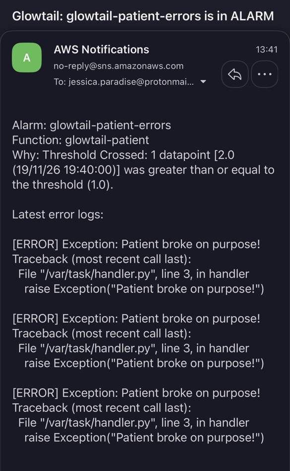

# Glowtail 🪲

**An AI-powered incident responder on AWS.** When something breaks, Glowtail catches the alarm, has Claude read the evidence, and emails you a plain-English summary of what went wrong and where to look first.

It catches trouble two ways: from **inside** (the code throws an error) and from **outside** (a Route 53 health check can't reach the app, the way a real user would notice).

> **Status:** 🚧 In progress. The core loop works end to end: break the patient, and the error logs land in my inbox within about two minutes. Next up: a Route 53 health check, then Claude. See [Progress](#progress).

## Why Glowtail?

When an app breaks at 3am, the first ten minutes are the same every time: find the alarm, dig through logs, figure out what actually happened. Glowtail does that part for you. It's the smoke alarm that also hands you the fire report.

Glowtail grabs the tail of your logs and makes it glow in your inbox.

## How it works

1. **Something breaks.** A test Lambda (the "patient") throws an error, or its `/health` URL starts returning 500.
2. **Two watchers notice.**
    - **From inside:** a CloudWatch alarm trips as soon as the patient logs an error.
    - **From outside:** a Route 53 health check pings the patient's URL from locations around the world. When it fails, a second CloudWatch alarm trips.
3. **EventBridge reacts.** One rule catches either alarm and wakes up the responder.
4. **The responder investigates.** It figures out which alarm fired, then gathers the evidence: the patient's latest error logs, and for a health check failure, the reason Route 53 gave.
5. **Claude explains.** Logs are scrubbed of secrets, then Claude summarizes what broke, the likely cause, and where to look first.
6. **You get the email.** Summary on top, raw evidence below, usually within a couple of minutes.

If Claude is ever unavailable, Glowtail still sends the raw evidence. The responder should never be the thing that breaks.

## Tech stack

| Area | Tools |
| --- | --- |
| Infrastructure as Code | Terraform (remote state in S3 with locking) |
| CI/CD | GitHub Actions with OIDC (no stored AWS keys) |
| Compute | AWS Lambda (with a Function URL for the patient) |
| Monitoring | Amazon CloudWatch (metrics, alarms, logs) |
| DNS & health checks | Amazon Route 53 health checks |
| Events | Amazon EventBridge |
| Notifications | Amazon SNS |
| AI | Claude on Amazon Bedrock |
| Security | Least-privilege IAM, log scrubbing before AI |

## Demo

Breaking the patient on purpose. A couple of minutes later, this lands in my inbox:



The alarm name, the function that broke, why the alarm fired, and the exact error and line of code. No digging through the console.

## Progress

**Phase 1: Foundation** ✅
- [x] Terraform remote state in S3 (versioned, encrypted, native S3 locking)
- [x] AWS Budget alert as a cost safety net
- [x] GitHub Actions pipeline with OIDC: pull requests run `terraform plan`, merges to `main` run `apply`
- [x] Trust policy scoped to this repo's `main` branch and pull requests only

**Phase 2: The patient and the alarm** ✅
- [x] Breakable "patient" Lambda (Python), deployed by the pipeline
- [x] CloudWatch alarm on the patient's errors, tested by breaking it on purpose
- [x] EventBridge rule that wakes the responder when the alarm goes into ALARM, locked down with a resource-based policy

**Phase 3: The responder** ✅
- [x] Responder reads the alarm event to find which function broke
- [x] Pulls that function's latest error logs from CloudWatch Logs
- [x] Emails them through SNS, with least-privilege access to one log group and one topic

**Phase 4: DNS health check**
- [ ] Patient gets a public `/health` URL with a "broken" switch
- [ ] Route 53 health check + CloudWatch alarm on its status
- [ ] Responder tells the two alarms apart and reports the health check's failure reason

**Phase 5: Add Claude**
- [ ] Claude on Bedrock summarizes what broke
- [ ] Secret scrubbing before logs leave the responder
- [ ] Fallback to raw evidence if Bedrock fails or times out

## Repo layout

```
glowtail/
├── bootstrap/            # Built once from a laptop: state bucket, budget, GitHub OIDC role
├── infra/                # Built only by the pipeline
│   ├── main.tf           #   providers, S3 backend, default tags
│   ├── variables.tf      #   inputs, like the alert email
│   ├── patient.tf        #   patient Lambda, its role, and its log group
│   ├── alarms.tf         #   CloudWatch alarms
│   ├── events.tf         #   EventBridge rule, target, and invoke permission
│   ├── responder.tf      #   responder Lambda, its role, and its permissions
│   └── sns.tf            #   alert topic and email subscription
├── lambdas/
│   ├── patient/          # The function we break on purpose
│   └── responder/        # Reads the alarm, pulls the logs, sends the email
├── docs/                 # Screenshots
└── .github/workflows/    # Plan on pull request, apply on merge to main
```

## Design decisions

- **Terraform state lives in S3, not on a laptop.** One source of truth, versioned, locked so two runs can't collide.
- **No stored AWS keys.** Locally I sign in with `aws login` (short-lived credentials), and GitHub Actions signs in with OIDC. Nothing permanent to leak.
- **Check from inside and outside.** Error alarms catch what the code knows went wrong. A Route 53 health check catches what users would actually experience, even when the code never logs an error.
- **Event-driven.** Nothing runs until something breaks, so it costs almost nothing when things are healthy.
- **One responder, many alarms.** A single EventBridge rule feeds one responder, which reads the alarm and decides what evidence to gather. The responder finds the failing function from the alarm event itself, so nothing is hard-coded.
- **Decoupled alerts.** The responder only publishes to an SNS topic. Who gets notified (email today, maybe Slack later) is a subscription change, not a code change.
- **Bootstrap vs. infra.** The state bucket and the pipeline's own role can't be built by the pipeline (chicken and egg), so they live in `bootstrap/` and are applied once by hand. Everything else lives in `infra/` and only changes through a pull request.
- **Least privilege.** Each piece can only touch what it needs. The patient can only write its own logs. The responder can read one log group and publish to one topic, and only one EventBridge rule is allowed to invoke it.
- **Short log retention.** Log groups are created by Terraform with 7-day retention, instead of letting Lambda create them with logs kept forever.
- **Scrub before AI.** Logs can hold keys, tokens, and emails. Those get masked before anything is sent to Claude.
- **Fail safe.** If the AI step fails, you still get the raw evidence.

## Cost

Glowtail is built to run cheap. Almost everything is serverless and only runs when an alarm fires. The one exception is the Route 53 health check, which has a small monthly fee, so it gets destroyed with Terraform between demos. The rough cost per incident (including the Claude call) will be listed here once measured.

## What I learned so far

- **Terraform state and bootstrapping.** Why state belongs in S3 with locking, and how to build the bucket that holds Terraform's own state by applying locally first, then migrating.
- **OIDC beats access keys.** GitHub hands each run a short-lived signed token; AWS only accepts it from this repo's `main` branch or pull requests.
- **Debugging a real OIDC failure.** The first pipeline run was rejected with "Not authorized to perform sts:AssumeRoleWithWebIdentity." Comparing the role's trust policy with what GitHub actually sent showed that new GitHub repos now use immutable subject claims (owner and repo IDs added to the `sub`). Updating the trust policy fixed it.
- **Plan before apply.** Reading the plan in the pull request ("0 to destroy") before merging, every time.
- **Alarms and missing data.** `treat_missing_data = "notBreaching"` keeps an alarm in OK when the function simply isn't running, instead of stuck in "insufficient data."
- **Regional vs. global.** Lambda and CloudWatch are regional, so the CLI has to point at `us-east-1`. IAM is global.
- **Two sides of a permission.** An IAM role says what a function *can do*. A resource-based policy on the function says *who can call it*. EventBridge needs the second one.
- **Read the event.** The alarm event already says which function broke and why. The responder uses that instead of guessing.
- **A green PR isn't a finished deploy.** One apply failed after merging: the plan didn't know the new SNS topic's ARN yet, and the AWS provider errored mid-apply. The responder kept running old code. I caught it because the expected "Sent alert" log line was missing, found the failed run on `main`, and re-ran it once the topic existed. Now I always check the `main` run after merging.
- **Confirm the subscription.** SNS email subscriptions stay "PendingConfirmation" until you click the link, and alerts sent before that are dropped.

## Author

**Jessica Paradise**

Cloud Support Engineer · AWS Certified Solutions Architect – Associate · AWS Certified Developer – Associate

- Website: [jessicaparadise.com](https://jessicaparadise.com)
- GitHub: [@jessicaparadise](https://github.com/jessicaparadise)
