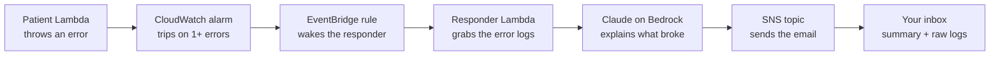

# Glowtail 🪲

**An AI-powered incident responder on AWS.** When something breaks, Glowtail catches the alarm, has Claude read the error logs, and emails you a plain-English summary of what went wrong and where to look first.

---

## Why Glowtail?

When an app breaks at 3am, the first ten minutes are the same every time: find the alarm, dig through logs, figure out what actually happened. Glowtail does that part for you. It's the smoke alarm that also hands you the fire report.

Glowtail grabs the tail of your logs and makes it glow in your inbox.

---

## How it works

1. **Something breaks.** A test Lambda (the "patient") throws an error on purpose.
2. **CloudWatch notices.** An alarm trips as soon as the error count hits 1.
3. **EventBridge reacts.** A rule catches the alarm and wakes up the responder.
4. **The responder investigates.** It finds which function broke and pulls its latest error logs.
5. **Claude explains.** Logs are scrubbed of secrets, then Claude summarizes what broke, the likely cause, and where to look first.
6. **You get the email.** Summary on top, raw logs below, usually within a couple of minutes.

If Claude is ever unavailable, Glowtail still sends the raw logs. The responder should never be the thing that breaks.

---

## Tech stack

| Area | Tools |
| --- | --- |
| Infrastructure as Code | Terraform (remote state in S3 with locking) |
| CI/CD | GitHub Actions with OIDC (no stored AWS keys) |
| Compute | AWS Lambda |
| Monitoring | Amazon CloudWatch (metrics, alarms, logs) |
| Events | Amazon EventBridge |
| Notifications | Amazon SNS |
| AI | Claude on Amazon Bedrock |
| Security | Least-privilege IAM, log scrubbing before AI |

---

## Design decisions

- **Terraform state lives in S3, not on a laptop.** One source of truth, versioned, locked so two runs can't collide.
- **No stored AWS keys.** GitHub Actions signs in with OIDC, so there's nothing to leak.
- **Event-driven.** Nothing runs until something breaks, so it costs almost nothing when things are healthy.
- **Least privilege.** Each piece can only touch what it needs. The responder can read one function's logs and publish to one topic.
- **Scrub before AI.** Logs can hold keys, tokens, and emails. Those get masked before anything is sent to Claude.
- **Fail safe.** If the AI step fails, you still get the raw logs.

---

## Cost

Glowtail is built to run for pennies. Everything is serverless and only runs when an alarm fires. The rough cost per incident (including the Claude call) will be listed here once measured.

---

## What I learned

> Coming soon, after it's built.

---

## Author

**Jessica Paradise**
Cloud engineer in training · AWS Certified Solutions Architect – Associate · AWS Certified Developer – Associate

- Website: [jessicaparadise.com](https://jessicaparadise.com)
- GitHub: [@jessicaparadise](https://github.com/jessicaparadise)
